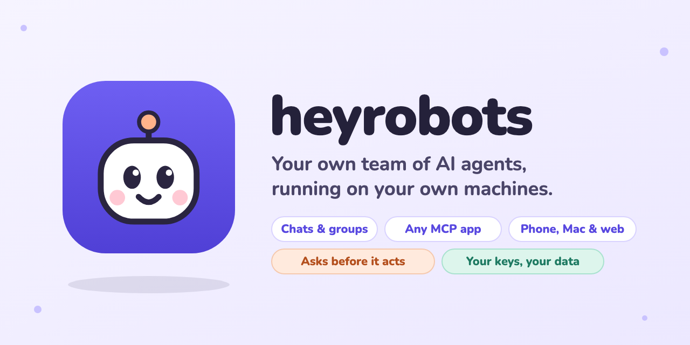

<!-- prettier-ignore -->
<div align="center">


# heyrobots

*Your own team of AI agents, running on your own machines*

[](https://github.com/sdsvn/heyrobots/actions/workflows/ci.yml)
[](https://github.com/sdsvn/heyrobots/releases/latest)
[](service/go.mod)
[](app/pubspec.yaml)
[](https://modelcontextprotocol.io)
[](https://agentclientprotocol.com)
[](#getting-started)

⭐ If heyrobots is useful to you, star it on GitHub!

[Features](#features) • [Getting started](#getting-started) • [Usage](#usage) • [Configuration](#configuration) • [Development](#development)



</div>

heyrobots is a team of AI agents that runs on your own Mac, Linux box or cloud machine. You chat with your agents from your phone, a browser or the Mac app, and they work with your mail, calendar, files and apps. Anything that reaches other people waits for your OK, and your chats, memory and keys never leave your machines.

> [!TIP]
> No API key needed: heyrobots can run on the [Claude Code](https://www.anthropic.com/claude-code) or [omp](https://omp.sh) subscription you already have.

## Features

- **A team, not one bot.** Each agent has its own job, tools, skills and model. Message one directly, or put several in a group: they answer, split the work with `@mentions` and hand each other the results.
- **Any brain.** Your own coding agent (Claude Code, omp), an API key (Anthropic, OpenAI, DeepSeek, Gemini) or a local model (Ollama, LM Studio). Switch models from the chat.
- **Any app.** A starter set (Gmail, Calendar, Linear, Notion, GitHub, Jira, Stripe, Figma, Zapier and more), search across the official MCP registry, or paste any MCP server link. Skills come from [skills.sh](https://skills.sh). An IT agent can set it all up for you.
- **Real work.** Agents run commands in their own task folder and share the files they make (PDFs, spreadsheets, images) as downloads in the chat.
- **Standing jobs.** Say "every weekday at 8, brief me" and the agent proposes a job; you confirm it, and it runs on schedule.
- **Safe by default.** Sending, posting and changing things wait for your approval. Content from outside, such as mail or web pages, is read in quarantine and treated as untrusted.
- **Always on, across machines.** The server runs as a background service. Several machines join into one team, and your phone is a window onto all of them.

## Getting started

### Install

On a Mac or Linux machine:

```bash
curl -fsSL https://raw.githubusercontent.com/sdsvn/heyrobots/main/install.sh | bash
```

This installs the server `heyrobotsd` in `~/.local/bin` (after checking its checksum), runs it as a background service that starts at login, installs the Mac app in `/Applications`, and opens it already signed in. On Linux, the web app opens in your browser, signed in.

Then pick a brain under **Settings → Brain**. Run the same line again to upgrade; your data stays.

<details>
<summary>Installer options</summary>

| Setting | What it does |
|---|---|
| `HEYROBOTS_VERSION` | Install a given release, such as `v0.4.2`, instead of the latest |
| `HEYROBOTS_INSTALL_DIR` | Put `heyrobotsd` somewhere else, such as `/usr/local/bin` |
| `HEYROBOTS_APP_DIR` | Put the Mac app somewhere else |
| `HEYROBOTS_NO_SERVICE=1` | Install the server only, and run it yourself |
| `HEYROBOTS_NO_APP=1` | Don't install or open the app |

Any other `HEYROBOTS_*` setting is passed on to the service, along with your `PATH`, so it finds `claude`, `omp` and `npx`:

```bash
curl -fsSL https://raw.githubusercontent.com/sdsvn/heyrobots/main/install.sh | HEYROBOTS_ACP_COMMAND="omp acp --model claude-sonnet-5-5 --thinking low --no-extensions" bash
```

</details>

### Pair your phone

Every start prints a QR code, the addresses to open and a one-time pairing code (in `~/Library/Logs/heyrobots.log` on a Mac, `journalctl --user -u heyrobots` on Linux). Scan the QR code with the app; it tries each address and keeps the first that answers. A paired device can make more codes under **Settings → Add a phone**, and `heyrobotsd pair` prints one any time.

> [!TIP]
> With [Tailscale](https://tailscale.com), the server listens on your tailnet by itself and leads with its MagicDNS name, such as `http://laptop.tail1234.ts.net:7340`. Only your own devices can reach it, and it works away from home.

Without Tailscale, add the machine's network address (`ipconfig getifaddr en0` on a Mac, `hostname -I` on Linux):

```bash
HEYROBOTS_LISTEN="127.0.0.1:7340,192.168.1.110:7340" heyrobotsd
```

### Get the apps

| Platform | How |
|---|---|
| Browser | Open the server's address. It serves the app itself. |
| macOS | Installed by the one-liner, or unzip `heyrobots-app-*-macos.zip` from [Releases](https://github.com/sdsvn/heyrobots/releases/latest) |
| Linux | Extract `heyrobots-app-*-linux-x64.tar.gz` and run `./heyrobots` (needs GTK 3 and libsecret) |
| Android | Copy `heyrobots-app-*-android.apk` to the phone and open it |

> [!NOTE]
> The Mac app isn't signed by Apple yet. Installed by the one-liner it just opens; downloaded in a browser, clear the download mark once: `xattr -cr /Applications/heyrobots.app`.

## Usage

| You want to… | Do this |
|---|---|
| Talk to one agent | Open its chat from **Chats** or **Agents** |
| Work with several | Start a group with the pencil on **Chats**. Write `both of you` or `everyone` to hear from each, or `@Name` for one |
| Connect an app | **Settings → Add-ons**: tap one, search the MCP registry or paste a link. Or tell the IT agent what you use |
| Teach a way of working | **Settings → Skills**: search skills.sh, add one, give it to an agent |
| Make something recurring | Say it in a chat, such as "every weekday at 8, brief me" |
| Approve an action | The card in the chat, or **Plans → Needs you** |
| Get a file an agent made | Tap **Download** on the file in the chat |
| Change an agent | Its page on **Agents**, or ask it ("from now on, …") |
| Delete a chat | Long-press or right-click it, or use its ⋯ menu |

Each agent works on up to 3 things at once (1–5), and one slot always stays free for your messages, so background jobs never make you wait.

> [!IMPORTANT]
> Signing in to an app such as Notion or Google returns to the server's own machine, so add apps from a browser or the app on that machine. The phone shows them but doesn't start sign-ins.

> [!WARNING]
> Agents run commands in their task folder as your user, without a sandbox, on your own tasks only. That suits a server on your own machine; don't run it on a shared one.

### Several machines, one team

1. On the machine others will dial: `HEYROBOTS_CLUSTER_LISTEN=192.168.1.110:7350 HEYROBOTS_MACHINE_NAME="Home Mac" heyrobotsd`
2. In its app: **Settings → Your machines → Add a machine**, which shows an address and a code.
3. On the other machine: **Settings → Your machines → Join a machine**, and enter them.

A laptop without a reachable address can still join; it only dials out. How the machines agree without voting is explained in [How heyrobots talks](design/architecture/heyrobots-communication.html).

## Configuration

| Variable | What it does | Default |
|---|---|---|
| `HEYROBOTS_LISTEN` | Addresses to listen on, separated by commas | `127.0.0.1:7340`, plus the tailnet address |
| `HEYROBOTS_DATA_DIR` | Where the database, keys and files live | `~/Library/Application Support/heyrobots` on a Mac, `~/.config/heyrobots` on Linux |
| `HEYROBOTS_VAULT_KEY` | Where the vault key is kept: `keychain` or `file` | `keychain` on a Mac, `file` elsewhere |
| `HEYROBOTS_SERVER_URL` | A public address, put first in pairing codes | — |
| `HEYROBOTS_TLS_CERT`, `HEYROBOTS_TLS_KEY` | Serve HTTPS with this certificate and key | plain HTTP |
| `HEYROBOTS_ACP_COMMAND` | The agent to run as "Your agent", such as `omp acp` | Claude Code through `claude-agent-acp` |
| `HEYROBOTS_AGENT_MODEL` | Claude Code's model | its own default |
| `HEYROBOTS_CLAUDE_CONFIG_DIR` | A separate Claude Code sign-in folder | your `~/.claude` |
| `HEYROBOTS_CLUSTER_LISTEN` | Where this machine's link to your other machines listens | none; it only dials out |
| `HEYROBOTS_CLUSTER_ADDRESS` | The link address other machines dial, if different | — |
| `HEYROBOTS_MACHINE_NAME` | This machine's name in the app | the host name |
| `HEYROBOTS_PUBLIC` | `true` for public mode, behind an access proxy (`HEYROBOTS_GUARD_*`) | off |
| `HEYROBOTS_MODEL_PRICES` | Prices for unknown models, as `model=in/out,…` per million tokens | built-in prices |
| `HEYROBOTS_DEBUG` | Log every detail, including the agent's own output | off |

For faster replies, use a quick model for your agent: Sonnet at low thinking answers in about 3–5 seconds, Opus in about twice that.

<details>
<summary>Day to day: logs, restart, uninstall</summary>

| | On a Mac | On Linux |
|---|---|---|
| Log | `~/Library/Logs/heyrobots.log` | `journalctl --user -u heyrobots` |
| Restart | `launchctl kickstart -k gui/$(id -u)/dev.heyrobots.heyrobotsd` | `systemctl --user restart heyrobots` |
| Is it running | `heyrobotsd status` | `heyrobotsd status` |
| New pairing code | `heyrobotsd pair` | `heyrobotsd pair` |

Uninstall on a Mac:

```bash
launchctl bootout gui/$(id -u)/dev.heyrobots.heyrobotsd; rm -f ~/Library/LaunchAgents/dev.heyrobots.heyrobotsd.plist ~/.local/bin/heyrobotsd; rm -rf /Applications/heyrobots.app
```

On Linux:

```bash
systemctl --user disable --now heyrobots; rm -f ~/.config/systemd/user/heyrobots.service ~/.local/bin/heyrobotsd
```

Your data stays in `HEYROBOTS_DATA_DIR`; delete it too to remove everything.

</details>

<details>
<summary>Installing the server by hand</summary>

Download the server for your machine from [Releases](https://github.com/sdsvn/heyrobots/releases/latest) and check it with `shasum -a 256 -c SHA256SUMS.txt --ignore-missing`.

```bash
tar -xzf heyrobotsd-*-darwin-arm64.tar.gz && cd heyrobotsd-*-darwin-arm64
xattr -c heyrobotsd   # macOS only: clears the download mark on an unsigned program
./heyrobotsd
```

To keep it running on Linux after you log out, copy it to `~/.local/bin`, save this as `~/.config/systemd/user/heyrobots.service`, then run `systemctl --user enable --now heyrobots && loginctl enable-linger "$USER"`:

```ini
[Unit]
Description=heyrobots

[Service]
ExecStart=%h/.local/bin/heyrobotsd
Environment=HEYROBOTS_LISTEN=127.0.0.1:7340
Restart=on-failure

[Install]
WantedBy=default.target
```

Setting up Gmail and Google Calendar is in [docs/setup/google.md](docs/setup/google.md).

</details>

## Development

You need Go (the version in [`service/go.mod`](service/go.mod)) and Flutter 3.47 or newer.

```bash
make build    # the web app, then bin/heyrobotsd with it inside
make run      # build and start the server at http://127.0.0.1:7340
make test     # the server's and the app's tests
make dev      # serve app/build/web from disk while you work on the app
```

The apps: `flutter build macos --release` (needs Xcode), `flutter build linux --release` (needs clang, cmake, ninja and GTK 3 headers), `flutter build apk --release` (needs the Android SDK and Java 17+). After changing [`api/openapi.yaml`](api/openapi.yaml), regenerate both sides with `go generate ./...` in `service/internal/api/gen` and `dart run swagger_parser` in `app`.

Pushing a version tag (`git tag v0.4.3 && git push origin v0.4.3`) builds every download and publishes a release with checksums.

| Folder | What's in it |
|---|---|
| [`service/`](service) | The server, in Go |
| [`app/`](app) | The app, in Flutter |
| [`api/`](api) | The OpenAPI contract between them |
| [`design/`](design) | Design documents and architecture pages |
| [`docs/`](docs) | Setup guides and images |
