# Make heyrobots a personal app: pick things, ask for things, never configure

## Context
The app grew screen by screen behind the server: settings forms, a tools page, a skills page that takes a pasted SKILL.md, schedules filled in by hand. You tried it and it felt like configuring a website, and it didn't look like the mockups. The direction now: one person's app on their own machine. Connections, MCP servers and skills are add-ons picked from a catalogue; anything recurring is asked for in a chat and the agent proposes it; the screens follow the "heyrobots app — cute redesign" canvas exactly. This is built; the review is of what was decided, with the feasibility advisor's findings folded in.

## Design
- Setup is two choices and a test, not a form
  - `/setup` keeps pairing only; the app's Setup screen shows "who does the work" and "who makes the quick calls"
    - the server probes this Mac: `claude` on PATH plus `claude auth status`, Ollama on :11434, LM Studio on :1234, and saved keys
    - a detected option needs no typing; a key provider opens one sheet with one field
    - both choices are tried once before "Let's go" works
  - the quick-calls roles need schema-bound JSON, not tool calls
    - their test asks for a JSON answer under a schema; suggested local models are qwen3 8B, or 4B on a small machine
  - Claude Code as "does the work" is the approved ACP worker (Release 5), not built yet
    - it will run the unmodified `claude` through the `claude-agent-acp` adapter under its own config folder, signed in once by the owner; heyrobots never stores a token
    - until then the card is greyed with "coming", so the screen never promises what the server can't do
    - what can go wrong: Anthropic moves headless use to a separate credit pool (announced, then paused); the card says it runs on the owner's limits
- Settings is six rows and one three-way choice
  - accept mode in words (Ask me / Suggest / Just do it); rows Brain, Add-ons, Skills, People, Spending, Add a phone
  - digest time, quiet hours and budget are asked for in chat and set through `set_setting`, with the owner's confirmation
- Connect apps is one catalogue for connections and MCP servers
  - a catalogue file in the server lists apps: name, category, kind (google, mcp, local), how to connect, what it does
    - the app shows it in sections with search and category chips; a connected app shows the account and a "+" for another
    - pasting an MCP link makes an entry from the server's own name once the gateway syncs it
  - "Connect" starts the flow the kind needs
    - Google: OAuth as today
    - MCP: register with the catalogue URL; a 401 with OAuth metadata starts the SDK's authorization-code flow (PKCE, dynamic client registration: Linear, Notion, Atlassian, Stripe); without it (GitHub, Slack) a pasted token
    - local (iMessage, Apple Calendar): the app shows the steps only the person can do in System Settings, and the server checks real access before saying "on"
  - Google can't be "no setup"
    - Gmail's scopes are restricted: an embedded client shows everyone an unverified-app screen, caps at 100 people, and verification needs a yearly assessment
    - so Google stays bring-your-own-client, as a guided walkthrough in the app (project, Desktop client, set it In production so tokens don't expire weekly)
  - one add-on's page shows what it can do as rows
    - reads run on their own; outward tools say "after your OK"; a few own-data tools (archive, label) are switches
    - "Who uses it" lists the agents with its toolset; "Give to…" adds the toolset to an agent
  - what can go wrong: an app's tools change → the entry stays and the existing review marks "new tools to look at"
- Skills come from a catalogue, not a paste
  - search covers installed skills, a curated list in the server, and any GitHub link to a folder with a SKILL.md
  - "Add" fetches the folder with one tree call and raw files, pinned to the commit it came from
    - it refuses links, submodules, more than 1 MB or 200 files, or no SKILL.md; scripts never run outside the sandbox
    - a newer commit later shows "update available" (not built yet)
- Asking makes jobs, rules and settings, with the owner's confirmation
  - the worker gets `make_job`, `make_rule` and `set_setting`; each proposes, never writes
    - it files an action in the outbox that needs approval; the chat shows a card with Confirm; only approval writes the job file, the rule or the setting
  - the tools are refused where lasting instructions could be planted
    - in a tainted task (it read mail or the web), in a delegate's task, and in a scheduled or job run, so a job can't make jobs
  - a proposed rule names only the running agent and only the toolsets its Mandate already has
  - the router accepts "every weekday at 8, brief me" as work for the agent that owns that area
    - the job name is a stable id, so "change it" updates rather than duplicates
    - days and time are parsed in code with the policy's timezone; the card shows the next two runs
    - job files are written whole (temp file, then rename)
  - what can go wrong: a proposed job fails validation → the tool answers the reason and the agent asks one question
- The agent's replies read like a colleague's
  - the worker prompt asks for specifics on what was done, next steps when there are any, and one offer at the end
- Plans tells apart what agents planned and what you set
  - every item carries its origin in one short line: "planned by Chief of staff", "you asked", or "when Linear labels an issue"; schedules you set are a section of their own, jobs agents proposed sit under "Planned by the team"
    - no extra chrome: the origin line replaces the agent-name line the mockup already has
- You chat with one agent or a group, like with people
  - a direct chat's thread belongs to one agent; a group's conversation offers the router only its members; "@Name" fixes the lead for that message
  - the chat list shows the last message, unread, "typing…" while an agent works, and what waits on you
  - a delegate may use a chat only when every agent in it is one its requests may go to
- The app follows the canvas exactly
  - three tabs Chats, Team, Plans; the screens above; Nunito, the palette and the card style from the canvas
  - every screen gets a screenshot compared with its mockup before it is called done (still to do)

## Alternatives
- A settings form for schedules and budgets next to chat: two ways to do one thing, and the form is what felt wrong.
- Letting the agent register MCP servers it finds by itself: the catalogue and the owner's tap keep "what is connected" the owner's choice.
- Agents writing jobs and rules directly, with a notice: an outside message could plant lasting instructions; confirmation keeps every lasting change the owner's.

## Open Questions
- Google: is the guided bring-your-own-client walkthrough acceptable, or should heyrobots ship one shared client for your own use only?
- Should a job missed while the Mac slept run once on wake (within three hours), or wait for the next scheduled time?

## Screenshots
The rebuilt app, captured at phone size from the packaged server with DeepSeek as the brain. Each follows the canvas board named in brackets.

| Pair [Pair] | Chats [Chats tab] | A chat [Scheduling by talking] |
|---|---|---|
| 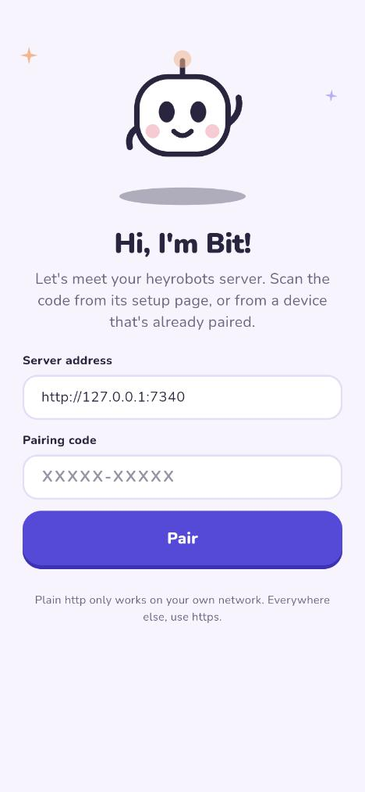 | 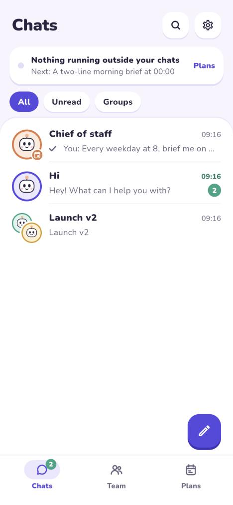 | 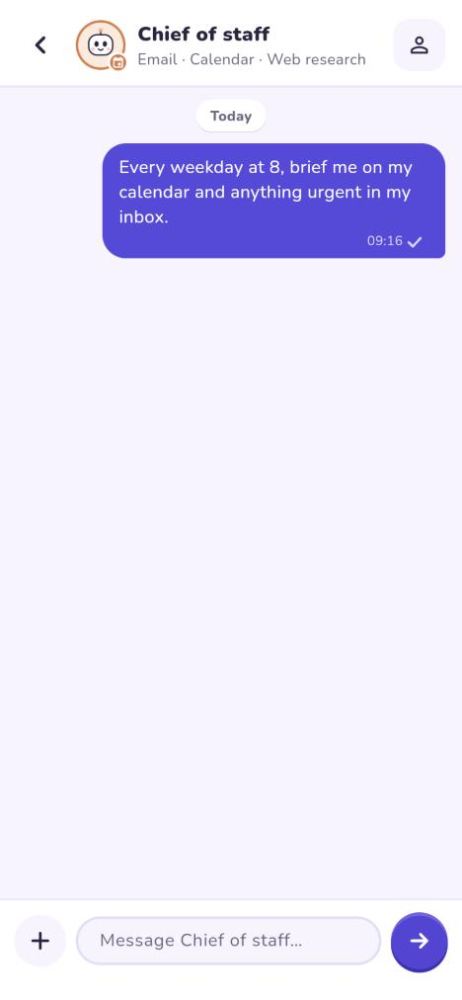 |

| Team [Team tab] | An agent [An agent: reach, work, jobs] | Plans [Plans tab] |
|---|---|---|
| 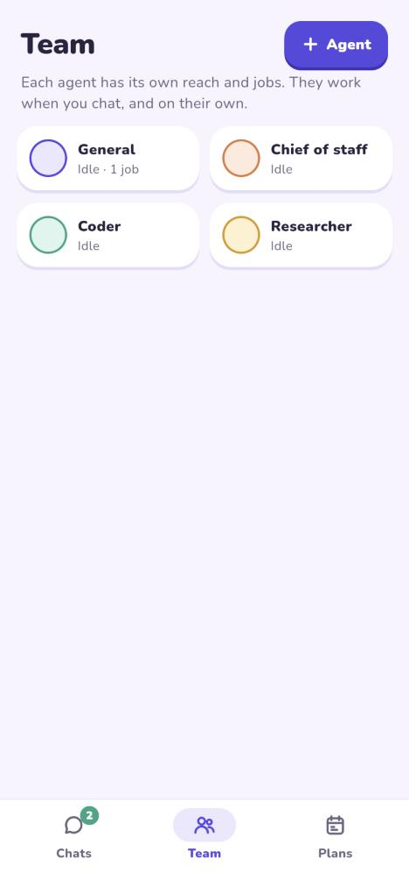 | 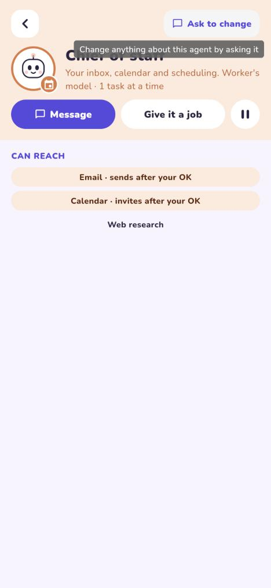 | 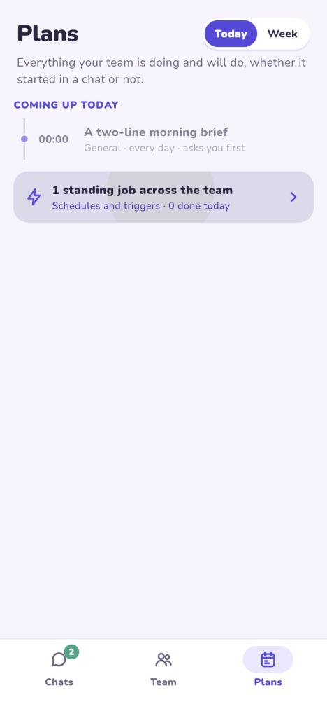 |

| Settings [Settings] | Setup [Setup: pick a brain] | Connect apps [Add-ons] |
|---|---|---|
| 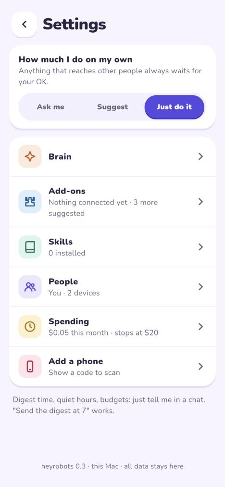 | 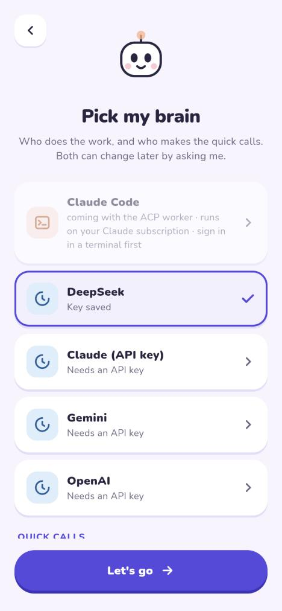 | 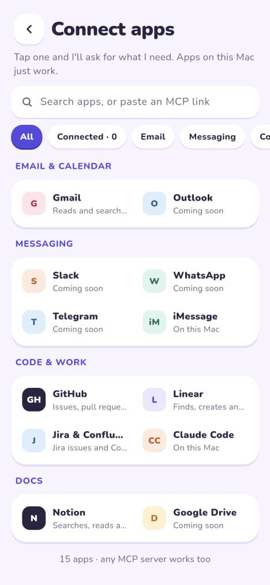 |

| Skills [Skills] | New group [New group] | Group chat [Group chat] |
|---|---|---|
| 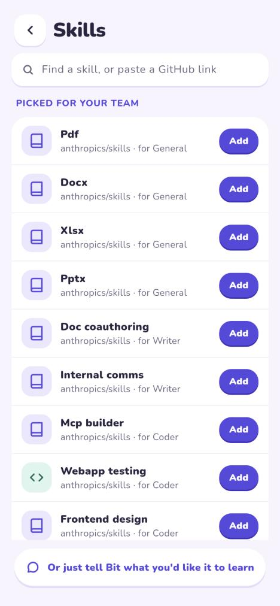 | 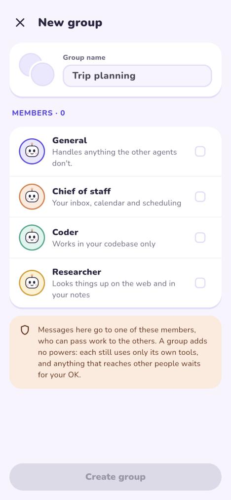 | 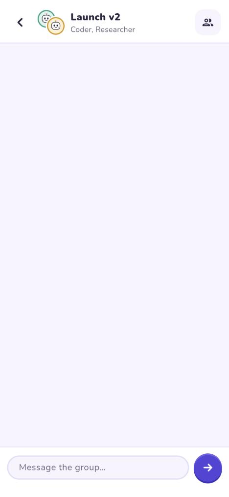 |

Known gaps seen while capturing: the Brain row in Settings has an empty second line; a group with no messages repeats its name as the last line; idle agents all render as small cards, so the Team tab shows big cards only once an agent is busy; the agent profile shows reach only until it has a task or a job; the one-tool-per-key-provider cards on Setup are three where the mockup shows one.
