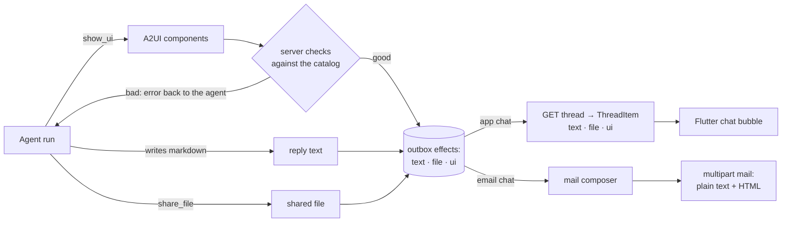
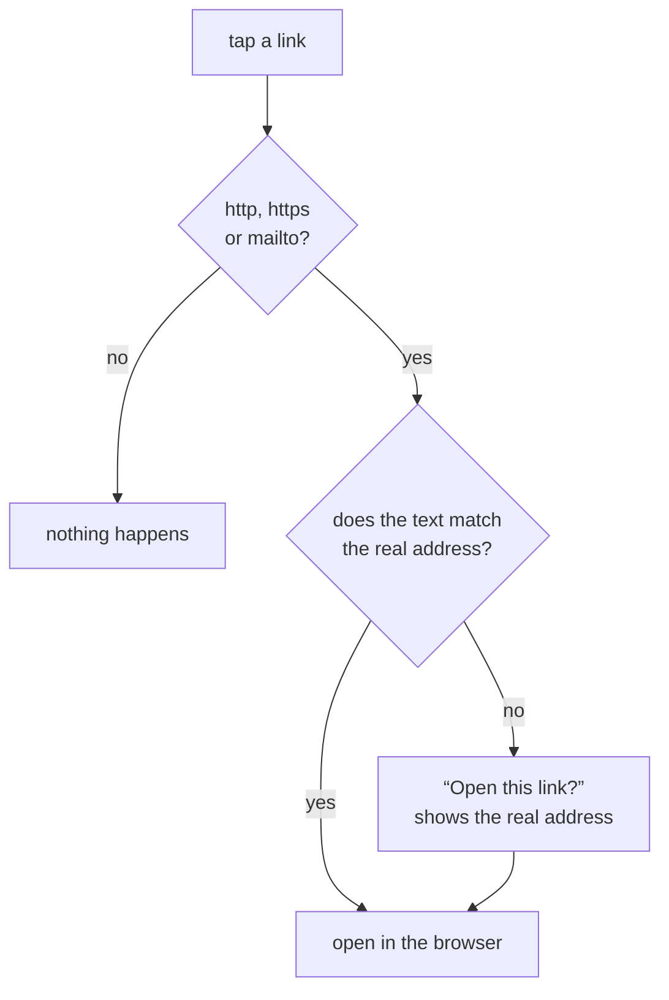

# How rich replies work

An agent's reply can reach you in four forms: **formatted text**, **pictures**, **PDFs** and **native cards**. Email carries the same replies as formatted mail. This page follows a reply from the agent to your screen.

## The big picture



Everything an agent says is stored as an **effect** in the outbox, the same as before. This change added one new kind, `ui`, and taught the app and the mail composer to draw what was already there.

---

## 1. Formatted text

The agent writes ordinary markdown. The app draws it, and your own messages stay plain text.

```
What the agent sends                      What you see
─────────────────────────                 ─────────────────────────
### Go 1.26 is out                        Go 1.26 is out          (heading)
Released **today**.                       Released today.         (bold)
- faster GC                               • faster GC
- new `iter` helpers                      • new iter helpers      (code font)
| OS    | Size  |                         ┌───────┬───────┐
|-------|-------|                         │ OS    │ Size  │  ← scrolls sideways
| macOS | 70 MB |                         │ macOS │ 70 MB │    if it's too wide
                                          └───────┴───────┘
```

**How**, in `app/lib/ui/rich_reply.dart` (`ReplyText`):

1. `hardBreaks()` turns single newlines into real line breaks, outside code blocks. Agents write lines, not paragraphs, so a list of times keeps its shape.
2. `flutter_markdown_plus` renders the text with a style sheet built from the app's Palette and Nunito, in light and dark. Tables size to their content and scroll sideways inside the bubble.
3. The text stays selectable.
4. The chat list preview uses `plainText()`, which strips the markup so a preview never shows `**`.

### Links say where they go



A reply can carry text copied from a web page, so `[your bank](https://evil.example)` shows you `evil.example` before it opens.

### Images in markdown

`` draws the picture inline, at most 320 points tall. Tap it to open full screen with pinch-zoom. Only `https` loads; anything else shows as a link with the alt text. In the browser build, `WebHtmlElementStrategy.fallback` lets pictures from sites without CORS headers load too.

---

## 2. Pictures and PDFs an agent shares

`share_file` stores the file as before. The bubble now looks at its type:

```
┌──────────────────────────────┐      ┌──────────────────────────────┐
│ ┌──────────────────────────┐ │      │ ┌──────────────────────────┐ │
│ │                          │ │      │ │ ▤▤▤▤▤▤▤▤                 │ │
│ │        the photo         │ │      │ │ ▤▤▤▤▤▤▤▤▤▤▤▤  page 1     │ │
│ │     (tap: full screen)   │ │      │ │ ▤▤▤▤▤▤      (tap: viewer)│ │
│ └──────────────────────────┘ │      │ └──────────────────────────┘ │
│ 📎 beach.jpg      [Download] │      │ 12 pages                     │
└──────────────────────────────┘      │ 📎 report.pdf     [Download] │
         an image                     └──────────────────────────────┘
                                                 a PDF
```

- **Same link as Download.** The picture and PDF load through the short-lived file link the Download button already used. `fileUrl()` caches each link until a minute before it expires, so scrolling doesn't ask the server again.
- **PDFs** are rendered by `pdfrx`. The bubble draws page 1. Tapping opens a viewer with every page.
- **Anything goes wrong** (expired link, damaged or locked PDF): the bubble falls back to the plain file tile.
- Video, audio and other files stay tiles.

---

## 3. Native cards (A2UI)

When choosing is easier than typing, an agent can call `show_ui` and send a small card instead of text.

### What the agent sends

```json
{
  "text": "Pick a time for the table: 7:00 pm or 8:30 pm.",
  "components": [
    {"id": "root",  "component": "Card",   "child": "col"},
    {"id": "col",   "component": "Column", "children": ["title", "row"]},
    {"id": "title", "component": "Text",   "text": "### Dinner on Friday"},
    {"id": "row",   "component": "Row",    "children": ["b1", "b2"]},
    {"id": "b1", "component": "Button", "child": "t1",
     "action": {"event": {"name": "pick_time", "context": {"time": "19:00"}}}},
    {"id": "t1", "component": "Text", "text": "7:00 pm"},
    {"id": "b2", "component": "Button", "child": "t2",
     "action": {"event": {"name": "pick_time", "context": {"time": "20:30"}}}},
    {"id": "t2", "component": "Text", "text": "8:30 pm"}
  ]
}
```

It's a flat list: each component has an `id`, and parents name their children by id. The one called `root` is the top. `text` says the same thing in words, for places that can't draw a card.

### What you see

```
┌────────────────────────────────┐
│  Dinner on Friday              │
│                                │
│  ┌───────────┐  ┌───────────┐  │
│  │  7:00 pm  │  │  8:30 pm  │  │
│  └───────────┘  └───────────┘  │
└────────────────────────────────┘
```

### The round trip

```mermaid
sequenceDiagram
    participant Ag as Agent
    participant Srv as Server (show_ui)
    participant Box as Outbox
    participant App as App
    participant You

    Ag->>Srv: show_ui(text, components)
    Srv->>Srv: check every component
    alt something is wrong
        Srv-->>Ag: error saying what to fix
        Ag->>Srv: show_ui(fixed components)
    end
    Srv->>Box: effect kind "ui"<br/>payload = A2UI messages, body = text
    Ag->>Srv: report ready (result may be empty)
    Box->>App: ThreadItem.ui = {messages}
    App->>You: draws the card
    You->>App: tap "7:00 pm"
    App->>Srv: sends the message "7:00 pm"
    Srv->>Ag: a new turn in the same chat
```

### What the server checks

`uiMessages()` in `service/internal/executor/ui.go` rejects a card unless:

| Check | Why |
|---|---|
| It's at most 64 KB | Cards are small. |
| Every component has a unique `id` | Children are found by id. |
| Each component is one the chat draws | The basic catalog without Video and AudioPlayer. |
| Each component matches the catalog's own JSON schema | The same `catalog.json` the app's `a2ui_core` 0.7.0 ships, embedded in the server. An `"h3"` Text variant fails here, not on your screen. |
| Images use `https` | The same rule as markdown images. |
| There's a `root`, and every child it names exists | The card can be drawn. |

When it fails, the agent gets the reason, along the lines of `component "title" (Text) doesn't match the catalog: /variant: value must be one of "caption", "body"`, and tries again. The card goes into the outbox wrapped as two A2UI messages, `createSurface` and `updateComponents`.

`show_ui` works only in app chats. Email can't draw a card, and the tool tells the agent to reply in text.

### How the app draws it

`UiSurface` feeds the messages to `a2ui_core`'s `MessageProcessor` and draws them with `a2ui_flutter`, themed like the rest of the chat. Text inside the card uses the same markdown renderer, made non-selectable so it doesn't swallow button taps. If anything fails to process, the bubble shows the agent's `text` instead.

### What a tap sends

`actionMessage()` turns the tap into a message in your words:

| You tap | Message sent |
|---|---|
| a button labelled **7:00 pm** | `7:00 pm` |
| **Book it** after typing *Ann* in a name field | `Book it (name: Ann)` |
| a button with no label | the action's name |

Values the agent wrote into the button itself (like `"time": "19:00"`) aren't repeated. The agent knows them already, and the label reads better in the chat.

### The card is the reply

Once an agent has shown a card, its end-of-task summary isn't posted under it, and it may finish with an empty result. You see the card, not the card plus "Showed a card with two times."

In the chat history the agent reads on its next turn, a card appears as `(showed buttons) ` followed by its text, so it remembers what it offered.

---

## 4. Email

Replies sent by email are now `multipart/alternative`:

```
Content-Type: multipart/alternative
├── text/plain   the markdown as written (reads fine as-is)
└── text/html    rendered by goldmark: headings, lists, tables, code
```

`HTML()` in `service/internal/sources/mail/html.go`:

- uses tables, autolinks, strikethrough, task lists and hard line breaks;
- **drops** raw HTML in the reply, since a reply can carry text from a web page;
- puts styles inline (tables, code, quotes), because most mail apps strip stylesheets.

Web images in the HTML are left to the mail app, which usually asks before loading them.

---

## Safety at a glance

| Risk | What stops it |
|---|---|
| A link's text hides where it goes | The real address is shown before it opens; only http, https and mailto open. |
| Odd image addresses (`file:`, `http:`) | Only `https` loads, in markdown and in cards. |
| HTML injected through a reply | The app's markdown doesn't render HTML; email drops it. |
| A malformed card | Schema-checked on the server; the text fallback in the app. |
| Shared files exposed more widely | Previews use the same short-lived link as Download. |

## Where the code lives

| Part | File |
|---|---|
| Markdown, links, images, PDFs, cards, tap messages | `app/lib/ui/rich_reply.dart` |
| Chat bubbles | `app/lib/ui/chat_screen.dart`, `thread_screen.dart`, `chats_tab.dart` (preview) |
| `show_ui` tool and checks | `service/internal/executor/ui.go` |
| Embedded catalog schema | `service/internal/executor/a2ui/` |
| "Card is the reply" rule | `service/internal/executor/control.go` |
| `ui` effect kind | `service/internal/store/outbox.go` |
| API field `ThreadItem.ui` | `api/openapi.yaml`, `service/internal/api/chat.go` |
| HTML email | `service/internal/sources/mail/html.go`, `compose.go` |
